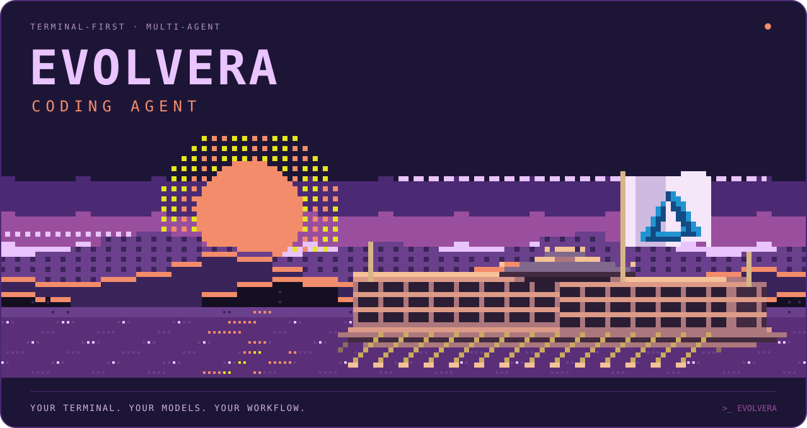

<p align="center">
  
</p>

<p align="center">
  <strong>Um workspace de agentes de código. No seu terminal.</strong><br>
  Modelos, agentes especializados, skills e ferramentas trabalhando no mesmo fluxo.
</p>

<p align="center">
  <a href="#comece-aqui">Instalar</a> ·
  <a href="#do-pedido-à-entrega">Como funciona</a> ·
  <a href="docs/setup.md">Documentação</a> ·
  <a href="docs/terminal-art.md">Design</a>
</p>

---

## Seu jeito de construir

**Evolvera Coding Agent** reúne um harness de desenvolvimento sobre o [PI Coding Agent](https://github.com/badlogic/pi): instruções de trabalho, agentes especializados, skills e extensões versionados juntos.

Você descreve o resultado. O agente principal escolhe entre agir diretamente ou delegar, acompanha a execução e reúne a entrega com evidência do que funcionou. O código, as ferramentas e a configuração continuam no seu ambiente.

| Uma base, vários caminhos | O que ela oferece |
| :--- | :--- |
| **Terminal primeiro** | Trabalhe no terminal ou no terminal integrado do VS Code. |
| **Agentes especializados** | Investigação, planejamento, implementação, design e revisão com responsabilidades próprias. |
| **Modelos configuráveis** | Providers e modelos definidos em configuração; cada agente pode ter sua própria rota. |
| **Skills sob demanda** | Procedimentos para tarefas concretas, carregados quando necessários. |
| **Extensões e MCP** | Comandos, hooks e ferramentas para conectar o agente ao seu fluxo. |
| **Orquestração com Orca** | Fluxo opcional de issues, worktrees e workers, com um conductor coordenando a entrega. |

## Comece aqui

Você precisa de **Git**, **Node.js ≥22.19.0**, **npm** e acesso a pelo menos um provider de IA. O runtime instalado por padrão é **`@earendil-works/pi-coding-agent@1.3.0`**.

> O repositório ainda está privado e em preparação para publicação. Os comandos abaixo usam seu endereço atual; o nome **Evolvera Coding Agent** é a identidade proposta para essa publicação.

### macOS / Linux

```bash
git clone https://github.com/Evolvera/evolvera.git
cd evolvera
./install.sh
pi
```

### Windows · PowerShell

```powershell
git clone https://github.com/Evolvera/evolvera.git
Set-Location evolvera
.\install.ps1
pi
```

Na primeira sessão, use **`/login`** para autenticar seu provider.

O [guia de instalação](docs/setup.md#início-rápido) cobre Node/fnm, Windows, WSL e a verificação do setup. Ele também explica o que os instaladores atualizam e o que preservam.

## Do pedido à entrega

```text
Seu pedido
    ↓
Agente principal + contexto do projeto
    ├── ação direta para trabalho simples
    └── agentes especializados quando ajudam
             ↓
        código + validação
             ↓
         entrega integrada
```

Um pedido pode ser tão simples quanto:

```text
Corrige o erro de autenticação e executa o teste afetado.
```

Ou pode envolver trabalho em paralelo:

```text
Planeja a integração, divide o trabalho independente e valida a entrega.
```

A configuração é explícita. Explore [os agentes](agents/), [as skills](skills/) e [as extensões](extensions/) para adaptar o harness ao seu projeto. As regras do agente principal ficam em [`SYSTEM.md`](SYSTEM.md).

## Além do terminal

- **VS Code:** seleção, arquivos abertos e diagnósticos pelo bridge da extensão. [Configuração e compatibilidade →](docs/setup.md#usar-no-vs-code)
- **PI Studio:** interface web do projeto, com documentação própria. [Conhecer o Studio →](interface/README.md)
- **Conductor:** coordenação de workers em worktrees no Orca. [Workflow Flow Orca →](skills/flow-orca/SKILL.md)

## Uma identidade própria

A paisagem de entrada traduz o **Acid Shellscape**, de **Kevin**, para pixel art nativa de terminal: céu roxo e coral, montanhas em camadas, reflexos e o navio Evolvera.

O banner acima foi renderizado a partir da implementação deste repositório. A referência privada de Kevin mantém seus direitos próprios; seu código e suas capturas não são redistribuídos aqui. [Composição, créditos e limites de uso →](docs/terminal-art.md)

Quer ver a arte sem acessar contas nem iniciar uma sessão de trabalho?

```bash
node scripts/preview-terminal-art.mjs --select
```

A seleção de contas no launcher real tem ativação separada dos instaladores. [Perfis e sessões →](docs/auth-only-accounts.md)

## Documentação

| Guia | Conteúdo |
| :--- | :--- |
| [Instalação e operação](docs/setup.md) | Setup completo, atualizações, uso diário, compatibilidade e troubleshooting. |
| [Contas e sessões](docs/auth-only-accounts.md) | Launcher gerenciado, credenciais e vínculo de conta por sessão. |
| [Arte de terminal](docs/terminal-art.md) | Identidade visual, renderização e preview. |
| [PI Studio](interface/README.md) | Uso e operação da interface web. |
| [Princípios de engenharia](ENGINEERING.md) | Convenções técnicas do projeto. |

## Publicação e licença

A abertura do repositório depende da limpeza do histórico sensível e da definição da licença. Até lá, esta apresentação **não concede uma licença open source**, nem altera as licenças de componentes de terceiros.

<p align="center"><sub>Construído pela Evolvera sobre o ecossistema PI.</sub></p>
