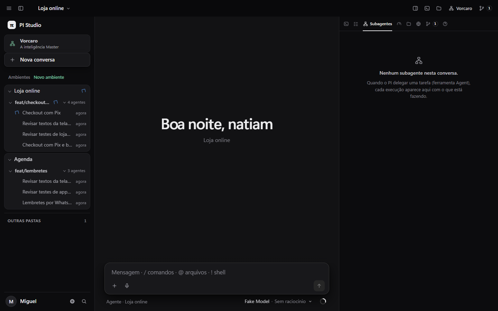
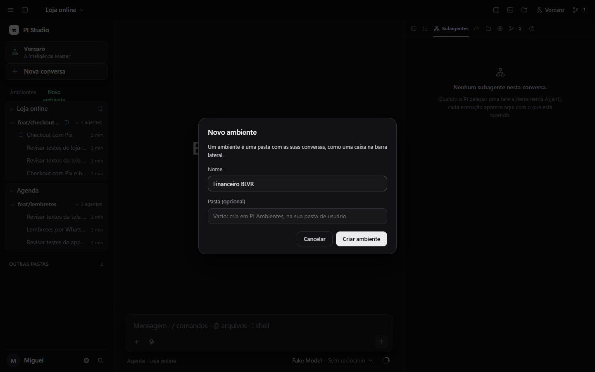

# Ambientes e o atalho do Vorcaro

Pedido: o PI Studio organizado como o app Claude, separado por ambiente (uma pasta que você cria), com as conversas guardadas naquela caixa, e o Vorcaro como atalho fixo no topo. Entregue no patch `studio-patches/0004-ambientes.patch`.

## Como fica

- **Topo da barra:** "Vorcaro, a inteligência Master" (abre o Vorcaro, igual a `Alt+V`) e "Nova conversa".
- **Ambientes:** "Novo ambiente" pede um nome e, se quiser, uma pasta que já existe. Sem pasta, o Studio cria `PI Ambientes\<nome>` dentro da sua pasta de usuário. O ambiente vira uma caixa com as conversas daquela pasta; dentro dela continuam as worktrees, e os forks e subagentes aparecem aninhados sob a conversa de onde saíram. A ordem é a de criação.
- **Outras pastas:** todas as pastas que o Studio encontra sozinho (histórico de sessões, benchmarks) ficam num grupo recolhido no fim, para não poluir. Sem nenhum ambiente criado, a barra fica como era.
- **Segurança:** sem pasta, o Studio só cria dentro de `PI Ambientes`. Uma pasta indicada precisa já existir, ser um caminho completo sem `..`, não ser pasta de rede nem a raiz do disco, e estar dentro da fronteira que o Studio já usa para abrir projetos: um projeto que ele conhece, uma pasta dentro das raízes de projeto ou de `PI Ambientes`, ou uma worktree listada pelo Orca (links são resolvidos antes da checagem). Fora disso, recusa (403). Uma pasta não vira dois ambientes. Renomear muda só o nome mostrado. Remover tira da lista e não apaga a pasta nem as conversas.

A lista fica em `~/.pi/agent/pi-studio-data/ambientes.json`.

## Testes

`test/ambientes.test.mjs`: nomes e pastas válidos e inválidos, pasta fora da fronteira (403), pasta indicada que não existe (400, e não é criada), pasta de rede (400), criação da pasta padrão, pasta existente, pasta duplicada e arquivo no lugar, renomear, remover sem apagar a pasta, leitura depois de reiniciar, as caixas na barra (ambientes primeiro e "Outras pastas" recolhido; sem ambientes, nada muda), o campo que chega do servidor e as rotas (criar, listar primeiro com o nome dado, aparecer na árvore, renomear, remover, sem token e entrada inválida). Suíte completa do Studio com os quatro patches: 681 aprovados, 0 falhas. Criação testada no navegador também: o diálogo fecha, a caixa aparece e o projeto abre.

## Falta

- Renomear e remover pela própria barra (hoje só pela API: `PATCH` e `DELETE /api/ambientes/<id>`).
- Arrastar uma pasta de "Outras pastas" para virar ambiente.
- Botão "+" de nova conversa dentro de cada caixa.
