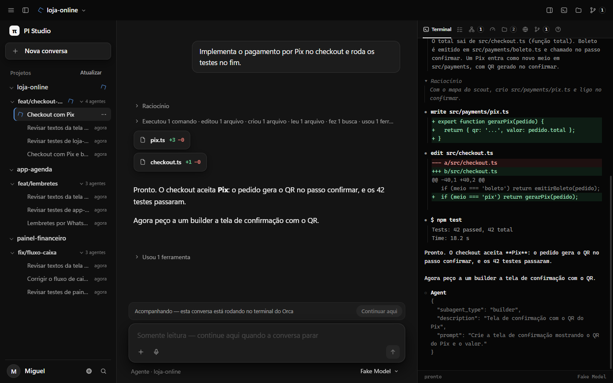
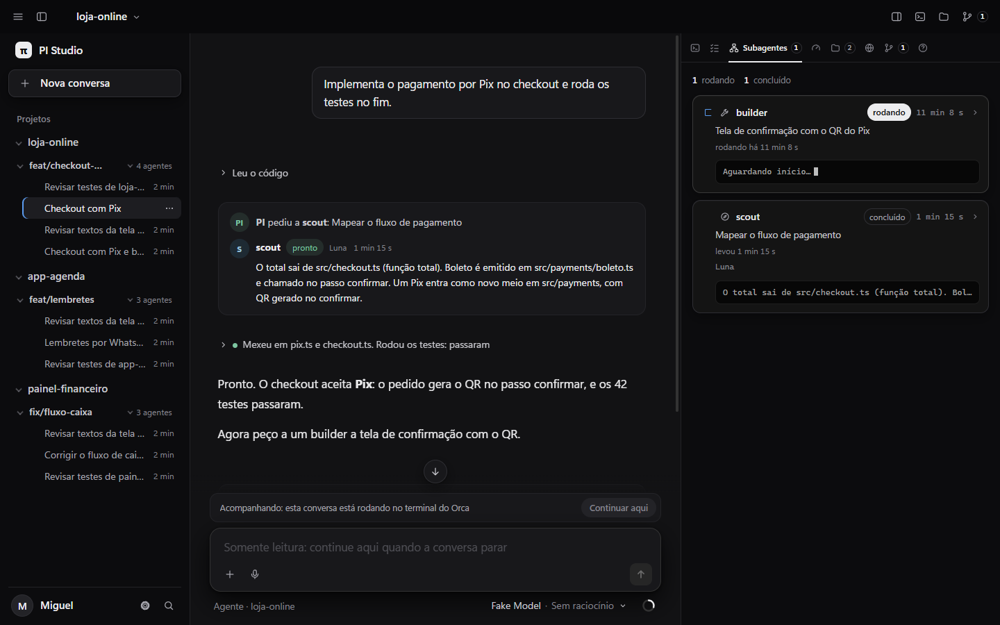

# Conversa simples no PI Studio

Pedido: o Studio deixar de ser coisa de código e diff, mostrar só as saídas, sem raciocínio, e deixar visível a conversa entre os agentes. Entregue no patch `studio-patches/0002-conversa-simples.patch`.

## Antes e depois

Mesma conversa sintética (pedido de Pix no checkout, um scout, edição, testes e um builder ainda trabalhando):

## O que mudou

- **Só as saídas por padrão.** Raciocínio não aparece na conversa, nem ao vivo. Cada bloco de trabalho vira uma frase curta: "Leu o código", "Mexeu em pix.ts e checkout.ts. Rodou os testes: passaram". Um ponto verde marca testes que passaram e um vermelho, testes que falharam. Clicar na frase mostra cada ferramenta, o raciocínio daquele trecho e os diffs.
- **A equipe conversando.** Cada vez que o PI delega, aparece um cartão de troca: "PI pediu a scout: Mapear o fluxo de pagamento", e a resposta do scout com avatar, estado (trabalhando, pronto, não concluiu, em segundo plano), modelo, tempo e custo. Enquanto o agente trabalha, o cartão diz "Trabalhando nisso".
- **Painel da direita na equipe.** Sem uma aba escolhida antes, o inspetor abre em Subagentes em vez do espelho do terminal (que mostra diff e JSON crus).
- **VeroNati.** Preto real (`#09090b`), texto grafite, verde sálvia (`#7cc4a0`) como único acento, nenhum texto abaixo de 12px, frases sem travessão nos textos que o patch tocou, movimento curto com `cubic-bezier(.32,.72,0,1)` e desligado quando o sistema pede menos movimento.
- **Volta ao modo técnico.** Configurações → "Detalhes técnicos na conversa" mostra tudo como antes (raciocínio, cada ferramenta e diffs).

O contexto continua visível no anel ao lado do modelo, embaixo do campo de mensagem (com a porcentagem na dica), e em detalhe na aba Contexto.

## Testes

`test/simple-view.test.mjs` (frases para cada tipo de trabalho e resultado de teste, reconhecimento dos comandos de teste, troca entre agentes em cada estado, transformação da linha do tempo mantendo a ordem e o estado aberto, assinatura de cache). Suíte completa do Studio com os dois patches: 659 aprovados, 0 falhas.

## Ficou para depois

- Tema claro seguindo o sistema (o Studio só tem tema escuro).
- Os traços longos que marcam valor vazio (CPU, memória, tokens sem leitura) e alguns textos fora das telas tocadas ainda usam travessão; trocar exige mexer em 9 testes do Studio.
- Fonte Plus Jakarta Sans servida pelo próprio Studio (hoje usa a fonte do sistema).
