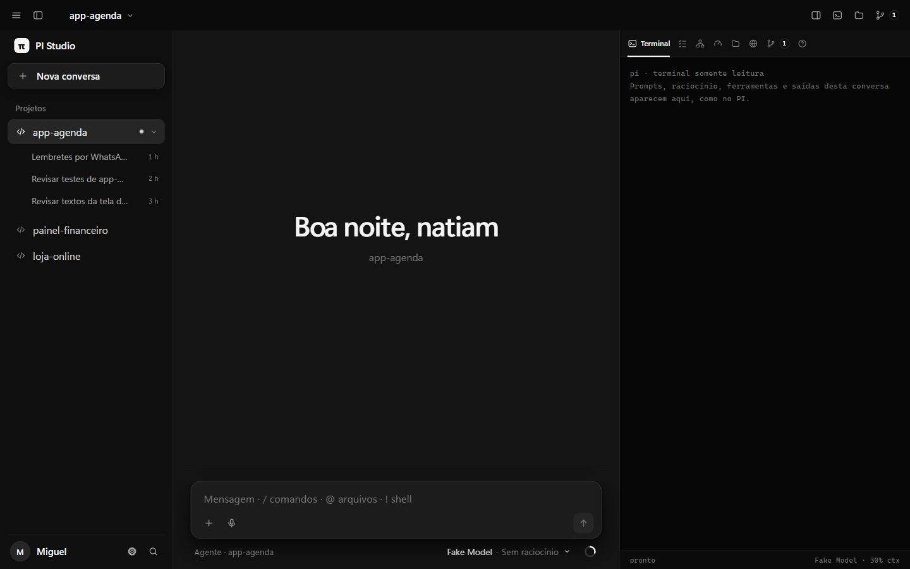
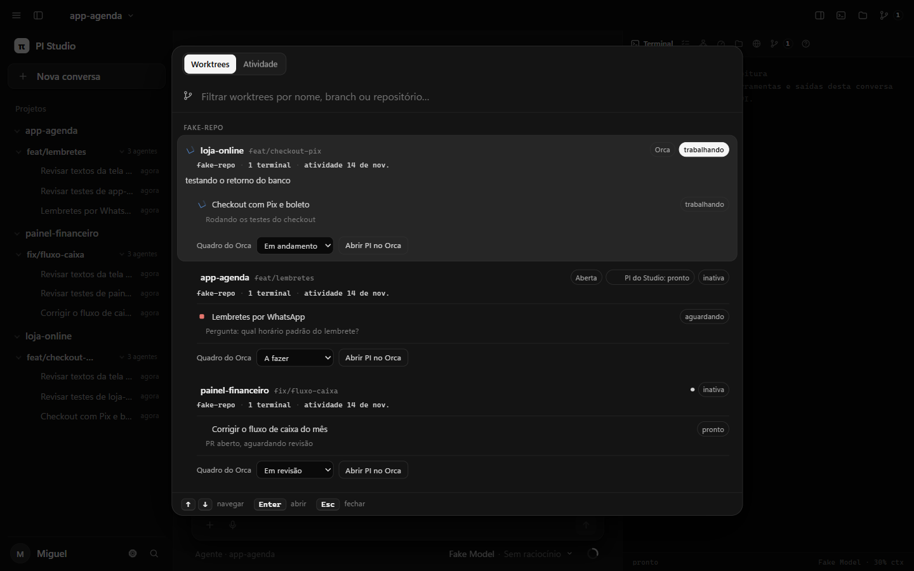
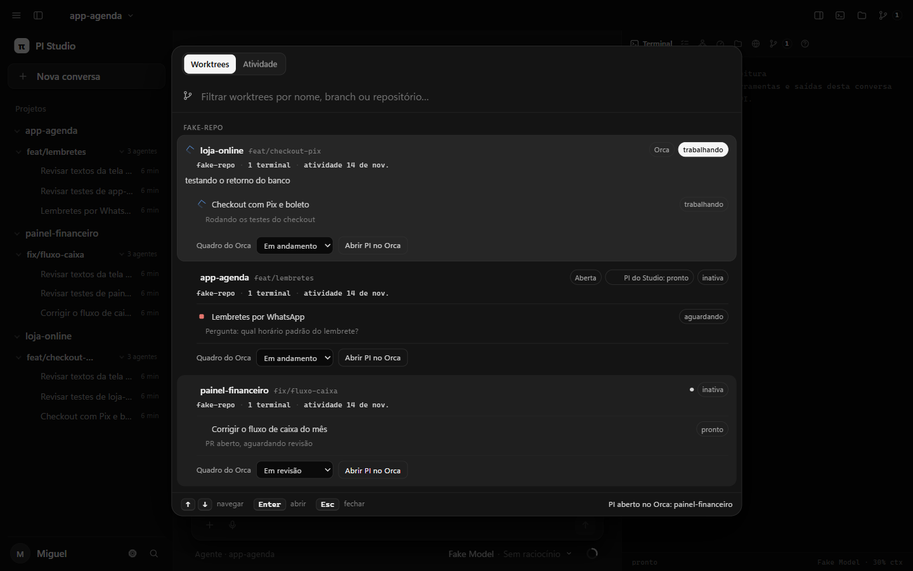

# PI Studio: desempenho medido e o que mudou

Medido em 28/10/2026 neste PC: Windows 11, 16 núcleos, Node 26.8.1, 732 sessões de PI (366 MB) em `~/.pi/agent/sessions`. Base: Studio no commit fixado `a3a9e74`. Depois: o mesmo commit com `studio-patches/0001-desempenho-e-orca.patch`.

## Resumo

| Situação | Antes | Depois |
|---|---|---|
| Servidor com a interface aberta e parada (CPU de 1 núcleo) | 15,3% | 7,7% |
| Leituras da lista de processos do Windows | 9 por min, cada uma abrindo um PowerShell novo (0,6 a 0,9 s de CPU) | 3 por min, num PowerShell que fica aberto (0,5% de CPU, 90 MB) |
| CPU total do Studio com a interface aberta (servidor + PowerShell) | cerca de 24% | cerca de 8% |
| Chamadas ao Orca | 20 por min | 8 por min |
| RAM do servidor com a interface aberta | 273 MB | 248 MB |
| Servidor com 5 projetos abertos | 15,1% | 6,1% |
| Servidor sem nenhuma janela aberta | 0,2% / 149 MB | 0,3% / 150 MB |

Cada PI aberto pelo Studio (`pi --mode rpc`) ocupa cerca de 195 MB (135 MB privados) e fica em 0,4% de CPU parado. Com 5 projetos abertos, os PIs somam 974 MB. As mudanças não afetam esse número: é o próprio PI com as extensões do harness.



## Método

Tudo em `scripts/studio/bench-studio.mjs`, que qualquer um roda de novo:

```bash
node scripts/studio/bench-studio.mjs --studio <pasta com server.mjs> --phase-ms 60000 --projects 5 --out resultado.json
```

- O Studio sobe numa porta livre (4199) com pastas temporárias: projetos novos, uma cópia das sessões reais (com as datas preservadas, como no uso real) mais uma sessão sintética longa (8.000 mensagens, cerca de 10 MB), e o Orca falso dos testes do Studio. Nenhum prompt é enviado ao PI.
- Um único PowerShell amostra a árvore de processos do servidor a cada 2 s (CPU por processo e memória de trabalho). CPU é o tempo de processador gasto na fase dividido pelo tempo da fase, em % de um núcleo.
- As leituras da lista de processos e as chamadas ao Orca passam por wrappers que contam cada chamada. Com `--direct-ps`, o Studio usa o próprio leitor (para medir o PowerShell persistente); os números de CPU do "depois" vêm desse modo.
- Fases: subida; 60 s sem navegador; Edge headless com a interface aberta (30 s de aquecimento, depois 60 s medidos); 5 projetos abertos (um PI cada), 60 s.
- O custo de uma chamada isolada é medido pelo próprio Windows: `TotalProcessorTime` do processo depois que ele termina, média de 3 a 5 execuções.
- Para achar os pontos quentes, o servidor rodou com `node --cpu-prof` por 120 s com a interface aberta; a análise considera só o trecho depois dos 40 s (sem a subida).

Resultados brutos de antes e depois: rodadas `final-before`, `final-after-counted` e `final-after` (os JSONs ficaram no rascunho da sessão; rode de novo para obter os seus).

## O que a medição mostrou

1. **Cada leitura da lista de processos abria um PowerShell novo.** No Windows o Studio usa `Get-CimInstance Win32_Process` para achar PIs vivos (os do Orca inclusive) e mostrar RAM/CPU. Abrir o PowerShell custa 0,6 a 0,9 s de CPU e 1,1 a 1,5 s por leitura; a mesma consulta num PowerShell já aberto custa 88 ms de CPU e cerca de 270 ms. Com a interface aberta eram 9 leituras por minuto, cerca de 9% de um núcleo só nisso, fora do processo do servidor.
2. **A árvore de conversas era o maior gasto do servidor.** A barra lateral pede `/api/tree` a cada 2 s. Cada atualização normalizava o caminho de cada sessão uma vez por projeto (cerca de 90 projetos × 731 sessões, só regex) e consultava `stat` e o fim de cada um dos 731 arquivos. No perfil, isso era 58% da CPU da thread principal em regime.
3. **A árvore puxava o Orca e a lista de processos junto**: uma chamada `orca worktree ps` a cada 2 s e uma leitura de processos a cada 5 s, mesmo com nada mudando.
4. **Orca fechado ainda custava**: cada `orca` com o app fechado gasta cerca de 80 ms de CPU e 0,5 a 1 s, e o Studio tentava de novo a cada 2 s.
5. A subida não mudou: cerca de 0,2 s até escutar, 3,4 a 3,8 s para descobrir os projetos e 4 a 4,5 s para indexar as 732 sessões na busca. O histórico da sessão de 10 MB abre em 23 a 36 ms.

## O que mudou no Studio

Tudo no patch `studio-patches/0001-desempenho-e-orca.patch`, com testes:

- **PowerShell persistente** (`lib-server/process-table.mjs`): um PowerShell fica aberto e responde a cada pedido. O pedido é um marcador aleatório enviado pela entrada padrão e devolvido no fim da resposta; o marcador nunca aparece na linha de comando do PowerShell (que a própria resposta lista). Fecha sozinho depois de 60 s sem uso; qualquer falha (erro, saída, tempo, saída grande demais) mata o processo e volta ao jeito antigo por 60 s.
- **Árvore** (`lib-server/tree.mjs`, `server.mjs`): caminho de cada sessão normalizado uma vez por atualização; sessões paradas há mais de 10 min reaproveitam o registro e são conferidas a cada 30 s (as recentes continuam sendo lidas a cada atualização).
- **Idade aceita por quem consulta**: a árvore aceita dados do Orca de até 10 s e lista de processos de até 15 s; o painel de recursos continua com 5 s e a lista de worktrees com 2 s.
- **Orca fechado**: a falha fica em cache por 15 s (antes 2 s).
- **Navegador**: o Orca é consultado a cada 3 s só com a lista de worktrees aberta, seguindo o Orca ou acompanhando uma conversa dele; só para o selo da barra superior, a cada 15 s.

Antes das correções, em regime e só na thread principal do servidor: 9,8% de um núcleo. Depois da normalização na árvore e dos ajustes do Orca: 3,6%. A diferença para os 7,7% medidos pelo Windows é trabalho fora da thread principal (threadpool do libuv para o sistema de arquivos e coleta de lixo).

## Orca dentro do Studio

Na visão geral de worktrees (`Alt+W`, botão de branch na barra), cada worktree do Orca ganhou:

- **Quadro do Orca**: escolhe a coluna da worktree (A fazer, Em andamento, Em revisão, Concluída; uma coluna própria aparece também). Usa `orca worktree set --workspace-status`.
- **Abrir PI no Orca**: abre um terminal novo com `pi` naquela worktree e traz o Orca para ele. Usa `orca terminal create --command pi --focus`.

O servidor só aceita uma worktree que o Orca lista naquele momento (pelo `worktreeId` exato). Com o Orca fechado, os controles não aparecem e a API responde 503. O resultado aparece no rodapé do diálogo (um aviso comum ficaria por baixo do diálogo).





As capturas usam projetos, sessões e um Orca sintéticos, sem nenhum dado real.

Ficou de fora, de propósito: painel de Runs, Tasks e workers da orquestração do Orca (`orca orchestration run-list`, `task-list`, `worker-list`) e a leitura do terminal de um worker. O Orca estava fechado durante o trabalho e a documentação não traz o formato do JSON dessas respostas; montar o painel sobre um formato adivinhado seria frágil. Com o Orca aberto, dá para capturar esse formato e fazer o painel com o mesmo padrão das rotas novas.

## PI no Studio comparado com PI num terminal do Orca

É o mesmo programa. No Studio o PI roda em modo RPC (sem desenhar a tela do terminal); no Orca roda com a interface de terminal dentro de um pseudoterminal. Em memória, cada um fica perto dos 195 MB medidos aqui; no Orca há ainda o processo do terminal e o próprio app Orca (Electron), que não foram medidos porque o Orca estava fechado. O custo próprio do Studio, depois das correções, é o servidor (150 MB parado, cerca de 250 MB com a janela aberta, 6 a 8% de um núcleo com a janela aberta) mais o PowerShell de 90 MB enquanto alguém olha a janela.

## Testes

- `npm test` do Studio com o patch, pelo caminho real de instalação (`sync-studio` numa pasta PI descartável): 652 aprovados, 0 falhas, 2 pulados pelo próprio Studio no Windows. O teste das DLLs NVIDIA da voz é filtrado porque este PC não tem Python 3.14.
- Testes novos: leitor persistente (reuso de um processo, marcador que aparece nos dados, saída por ociosidade, volta ao jeito antigo, um teste com PowerShell de verdade), idade aceita da lista de processos e do Orca, cache do Orca fechado, árvore com 90 projetos × 800 sessões, regra de reaproveitamento das sessões paradas, argumentos do `orca worktree set` e do `orca terminal create`, e as rotas novas com o Orca falso (inclusive worktree fora da lista, corpo inválido, sem token e Orca fechado).
- Rodada real da cópia instalada (porta 4197, histórico real só leitura): `/api/health`, `/api/orca` (Orca fechado: `available:false`), `/api/resources` (265 ms na primeira, 200 ms na seguinte, com o PowerShell persistente como filho do servidor), `/api/tree` e `/api/projects/status` respondem 200; `POST /api/orca/worktree-set` com o Orca fechado responde 503. A primeira montagem da árvore com as 732 sessões leva 9,8 s (cálculo inicial dos títulos, igual na base); depois vem do cache. Ao encerrar o servidor, o PowerShell persistente sai junto.
- Instabilidade conhecida: o teste "real server: an idle unwatched Studio PI is stopped..." (`test/idle-reaper.test.mjs`) depende de tempo. Passa sempre sozinho; com a suíte inteira passou 3 de 5 vezes com o patch e 3 de 3 na base. O patch não toca o caminho desse teste (sessões, SSE e o encerramento de PIs ociosos); a hipótese é a carga extra dos arquivos de teste novos rodando em paralelo. Por isso o `sync-studio` repete o `npm test` uma vez quando a primeira rodada falha e mostra os nomes do que falhou; uma falha que se repete continua bloqueando a instalação.

## O que ainda dá para melhorar

- A árvore ainda lista as 87 pastas de sessão a cada 2 s; um observador de pasta trocaria isso por eventos.
- O Studio encerra PIs abertos por ele depois de 15 min sem ninguém olhando (`PI_STUDIO_IDLE_PI_MINUTES`, 5 a 240). Com 5 PIs, isso devolve cerca de 1 GB; o padrão foi mantido.
- A voz exige `py -3.14` no Windows (este PC tem 3.12); veja `avaliacao.md`.
- Tornar o teste de encerramento de PIs ociosos independente de tempo, junto com o Miguel (o teste é dele).
