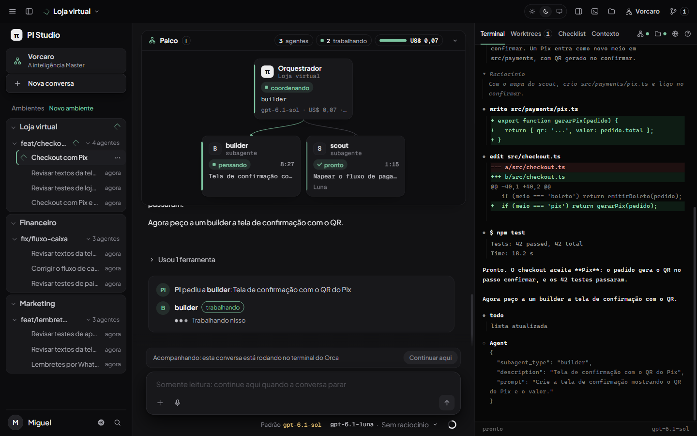
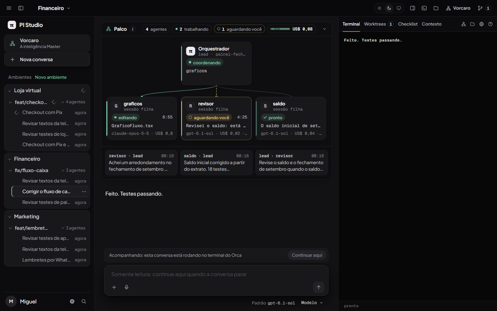
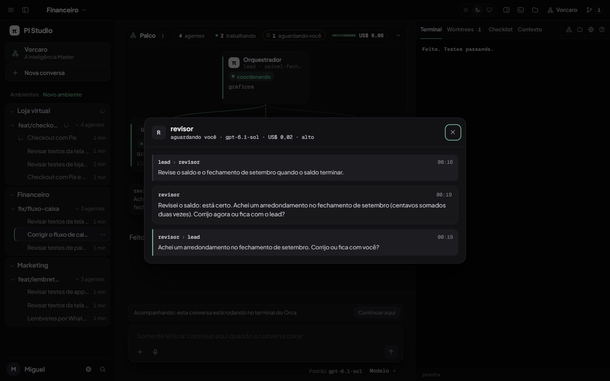

# Palco dos agentes: o novo PI Studio

Pedido: uma tela limpa com os agentes trabalhando, cada um com a sua parte; equipe quando é equipe, um agente quando é um; chat central só com saídas; terminal ao lado com worktrees, checklist e contexto; visual técnico e futurista sem exagero, para quem olha entender que tem trabalho acontecendo. Entregue no patch `studio-patches/0005-palco-dos-agentes.patch`.

## Como a tela se divide

- **Palco, no topo do centro.** Um nó por agente vivo: o orquestrador (o PI desta conversa), os subagentes que ele chamou e, numa equipe, o lead e as sessões filhas abertas com `team_start`. Cada nó mostra nome, papel, estado (pensando, lendo, editando, testando, executando, aguardando você, coordenando, pronto, pronto e verificado, não concluiu), o arquivo ou passo atual, o cronômetro, o modelo, o custo e o esforço. A borda esquerda e o selo usam a cor do estado; nada mais tem cor.
- **Árvore.** O lead fica em cima e os filhos embaixo, ligados por linhas. A linha é contínua e verde enquanto o filho trabalha, tracejada e âmbar quando ele espera alguém, cinza quando terminou. Quando um trabalho ou uma mensagem passa (o PI delegou, o filho entregou, alguém escreveu no time), um traço percorre a linha uma vez, na direção em que a coisa foi. Não há animação em loop.
- **Um agente só:** um nó calmo, centralizado, sem árvore.
- **Mensagens da equipe:** as três últimas aparecem numa faixa embaixo da árvore (de quem, para quem, hora, texto).
- **Resumo na linha do título:** quantos agentes, quantos trabalhando, quantos esperam você e o custo total com uma barra dividida por agente. O palco recolhe pela seta e lembra a escolha.
- **Clicar num nó abre a conversa daquele agente:** o orquestrador volta ao chat principal, um subagente abre a conversa dele em modo acompanhamento, e uma sessão filha da equipe abre um painel só com as respostas dela e as mensagens que ela trocou.
- **Chat central só com saídas** (a conversa simples do patch 0002): respostas e o trabalho em frases curtas, raciocínio fora da tela.
- **Bancada à direita:** Terminal, Worktrees (Orca), Checklist e Contexto como abas com nome; Agentes, Arquivos, Navegador e Dúvidas como ícones no canto, com um ponto verde quando têm novidade. Quando a bancada estreita, as abas viram ícones.

## De onde vêm os dados

- Orquestrador: o próprio estado da conversa no Studio (fase, ferramenta rodando, mensagens, custo das respostas, modelo e esforço). "Pronto e verificado" quando os testes rodaram depois da última edição e passaram.
- Subagentes: a mesma coleta da aba Agentes (`collectSubagents` e a árvore de sessões).
- Equipe: rota nova `GET /api/teams/current?project=<id>` (`lib-server/teams.mjs`), que lê só leitura `~/.pi/agent/teams/<time>/members/*.json`, `messages.jsonl` e o fim de `logs/<nome>.jsonl` (até 256 KB por log, resumo guardado enquanto o arquivo não muda). O time de uma conversa é o mais recente cujo lead (ou algum membro) trabalha na pasta dela. `GET /api/teams/member?team=&name=` devolve a conversa de um membro: só respostas e mensagens, sem raciocínio. Nomes passam pela mesma regra do team-bus (`[\w.-]+`, sem `..`). O palco consulta a cada 5 s, só com um projeto aberto e a janela visível.

## Visual

- Preto real `#09090b` e tema claro em branco quente `#f8f8f7`, texto grafite, um único acento verde floresta (`#1f6f5c` no claro, sálvia `#7cc4a0` no escuro). Cores de estado só para estado. Sol, lua e monitor no topo escolhem claro, escuro ou o do sistema; a escolha é aplicada antes do primeiro desenho (`boot.js`).
- Plus Jakarta Sans para texto e Geist Mono para telemetria, servidas pelo próprio Studio (`public/fonts`, licença OFL em `LICENSES.txt`). Nada abaixo de 12px; números em `tabular-nums`; custo no formato brasileiro (US$ 0,07).
- Movimento só com motivo e com a curva `cubic-bezier(.32,.72,0,1)`: um nó entra subindo, o selo troca quando o estado muda, a linha acende quando algo passa. "Reduzir movimento" (do sistema ou das configurações) desliga tudo.
- O terminal continua escuro nos dois temas, como um painel de instrumento.
- `scripts/varrer.py` da VeroNati passa sem achados em `public/` e `lib-server/`. Para isso o "—" de valor ausente virou "n/d" no Studio inteiro.

## Desempenho

O ganho de CPU medido antes continua: com a janela aberta e parada, servidor 5,8% de um núcleo mais 0,4% do PowerShell (antes do redesign, cerca de 8%), 179 MB no servidor; sem janela, 0,3%. Medido com `node scripts/studio/bench-studio.mjs --phase-ms 30000 --projects 2 --direct-ps` neste PC, com outras sessões rodando. O palco só redesenha um nó quando o que ele mostra muda, consulta a equipe a cada 5 s com a janela visível e lê cada log de membro de novo só quando o arquivo muda.

## Capturas

| Tela | Escuro | Claro |
|---|---|---|
| 1440x900 | [palco-1440-escuro.png](palco-1440-escuro.png) | [palco-1440-claro.png](palco-1440-claro.png) |
| 1366x768 | [palco-1366-escuro.png](palco-1366-escuro.png) | [palco-1366-claro.png](palco-1366-claro.png) |
| Equipe (1440x900) | [palco-equipe-escuro.png](palco-equipe-escuro.png) | [palco-equipe-claro.png](palco-equipe-claro.png) |

Antes: [studio-principal.png](studio-principal.png) e [conversa-depois.png](conversa-depois.png). Todas as capturas usam dados sintéticos de `studio-tools/shots-server.mjs` (porta 4198), sem gastar tokens; o servidor agora também cria uma equipe com três sessões filhas, os logs e as mensagens delas, e dois pedidos do Vorcaro já acompanhados.

## Testes

`test/agent-stage.test.mjs`: estado e passo de cada ferramenta, "pronto e verificado" só com teste depois da última edição, os três modos (um agente, agente com subagentes, equipe em árvore com mensagens e direção das linhas), custo e cronômetro, leitura dos logs da equipe (modelo, esforço, custo, ferramenta rodando, só respostas), achar o time pela pasta e recusar nomes com `..`, tema aplicado antes do primeiro desenho, e o contrato visual (fontes locais, tema claro, nada abaixo de 12px, nenhuma animação em loop, movimento reduzido respeitado).

## Ficou para depois

- Seleção por teclado entre os nós com as setas (hoje cada nó é um botão na ordem de tabulação).
- Netos (um subagente de uma sessão filha) aparecem quando a sessão filha é a conversa aberta; na visão do lead, o palco mostra só filhos.
- O custo de uma sessão filha é o das respostas que estão nos últimos 256 KB do log dela.
