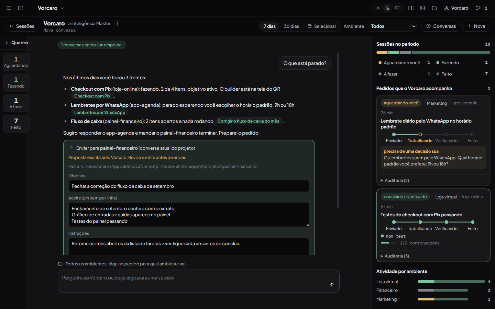
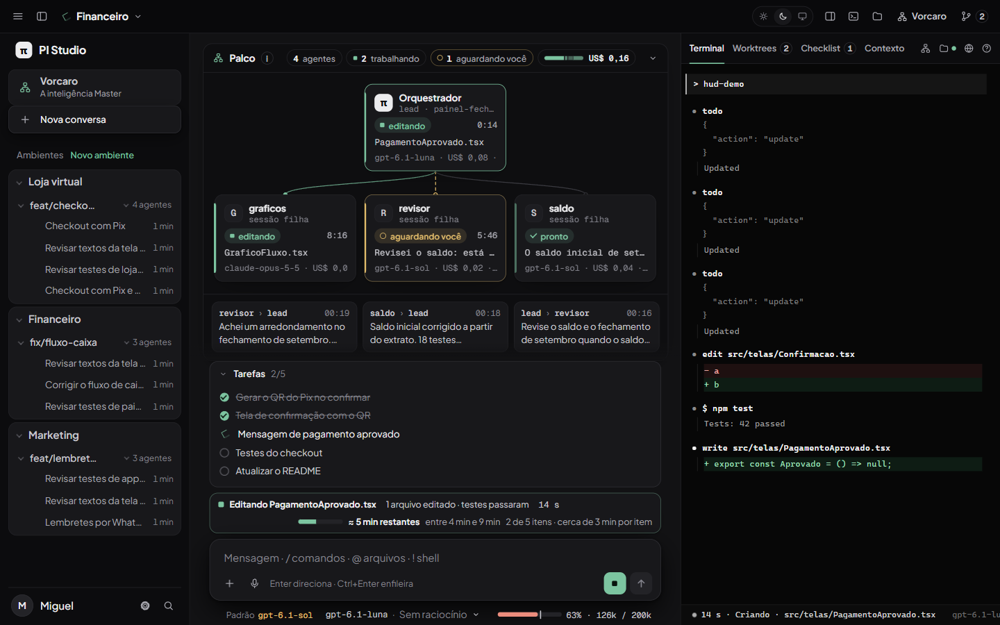

# Tela do Vorcaro e HUD do Studio

Ajustes pedidos depois do palco (patch `studio-patches/0007-tela-do-vorcaro-e-hud.patch`): o Vorcaro vira uma tela própria, e o Studio passa a mostrar o modelo de verdade, o contexto com o ponto de compactação, o que o agente está fazendo agora e quanto falta.

## Tela do Vorcaro

- **Tela própria, não um modal.** O botão Vorcaro (ou `Alt+V`, ou o atalho na barra lateral) troca a barra lateral, o chat e a bancada por uma tela com três partes: o quadro à esquerda, a conversa com o Vorcaro no centro e o que ele acompanha à direita. "Sessões", no canto superior esquerdo (ou `Esc`), volta às suas conversas. `?vorcaro=1` na URL reabre a tela.
- **Quadro (Kanban) à esquerda, recolhido no começo.** Recolhido, é uma coluna com os quatro números (Aguardando, Fazendo, A fazer, Feito); um clique abre e fecha. Aberto, mostra os cartões das sessões em quatro colunas.
- **À direita, o trabalho visível:** a barra das sessões do período por estado (clicar numa legenda abre o quadro), os pedidos que o Vorcaro acompanha com as quatro etapas (Enviado, Trabalhando, Verificando, Feito), o motivo do bloqueio, as verificações e as continuações, e a atividade por ambiente (ou por projeto, com um ambiente filtrado).
- **A conversa é uma sessão salva.** O PI do Vorcaro agora grava a sessão (`--session-dir ~/.pi/agent/pi-studio-data/conversas`, nunca em `~/.pi/agent/sessions`, para não virar resumo de si mesmo). "Conversas" lista as anteriores, um clique reabre com o histórico (só perguntas e respostas) e continua com `--session <arquivo>`; a última fica lembrada. Dois processos nunca abrem a mesma conversa.
- **Filtros (barra única, a mesma para outros quadros):** período com 7 dias, 30 dias e "Selecionar" (calendário de início e fim); ambiente com "Todos" ou um. Filtro ativo vira chip com "x" e "Limpar filtros", e tudo fica na URL (`periodo`, `de`, `ate`, `ambiente`). Valem para o quadro, os pedidos e a atividade.
- **Ambiente como contexto.** Com um ambiente escolhido, o quadro mostra só ele, e cada pergunta ao Vorcaro leva uma linha de contexto ("ambiente Marketing, pasta ...") que ele usa para mandar pedidos novos para lá sem perguntar; a linha não aparece na conversa. Com "Todos", cada cartão mostra a etiqueta do seu ambiente e o Vorcaro usa o ambiente que você disser (ou pergunta).

| Quadro | Todos | Marketing |
|---|---|---|
| Recolhido | [vorcaro-tela-recolhido-todos.png](vorcaro-tela-recolhido-todos.png) | [vorcaro-tela-recolhido-marketing.png](vorcaro-tela-recolhido-marketing.png) |
| Aberto | [vorcaro-tela-aberto-todos.png](vorcaro-tela-aberto-todos.png) | [vorcaro-tela-aberto-marketing.png](vorcaro-tela-aberto-marketing.png) |

Conversas salvas: [vorcaro-tela-conversas.png](vorcaro-tela-conversas.png). Continuam valendo: chat só com saídas, verificação própria antes de "feito", proposta editável e enviada só depois do clique.

## HUD: modelo, contexto, atividade e tempo

- **Modelo de verdade.** O botão do modelo mostra o id do modelo em uso (ex.: `gpt-6.1-luna`), não um nome de exibição. Ao lado, em âmbar quando diferente, o padrão das configurações do PI (`defaultProvider/defaultModel/defaultThinkingLevel`, lidos de `~/.pi/agent/settings.json` pela rota `/api/pi-settings`, que só devolve essas chaves e a compactação). "Em uso" vem do carimbo da última resposta (`provider`, `model`, `thinkingLevel`); se o seletor disser outro, o botão ganha um contorno e o tooltip explica. Os nós do palco usam o mesmo carimbo, inclusive o modelo de cada sessão filha.
- **Barra de contexto** no lugar do anel: tokens usados, janela e porcentagem ("63% · 126k / 200k"), cor por faixa, e uma marca onde o PI compacta sozinho (janela menos `compaction.reserveTokens`; no NatiamG, 65.536). O tooltip diz quanto falta para compactar e quando houve a última compactação. Clicar abre a aba Contexto.
- **Linha de atividade** acima da caixa de mensagem, sempre visível enquanto o agente trabalha: o que ele faz agora em palavras ("Editando PagamentoAprovado.tsx", "Rodando os testes", "Lendo checkout.ts", "Pensando"), o que a rodada já fez ("1 arquivo editado · testes passaram") e o tempo. Na conversa simples ela substitui a linha de andamento que ficava no meio do chat.
- **Estimativa honesta, sem chamar modelo:** pelo checklist (média e faixa do tempo dos itens já concluídos vezes os que faltam: "≈ 5 min restantes · entre 4 min e 9 min · 2 de 5 itens"), com barra de progresso. Sem checklist, pela mediana das últimas rodadas deste projeto guardadas no navegador ("costuma levar 4 min"). Com pouco dado, diz que ainda não sabe. Parado, mostra só o progresso.
- **Recibo da última rodada:** tempo, arquivos alterados e custo, com "Ver arquivos" (padrão do Claude Code e do Cursor).
- **O que saiu:** contagens como "MCP: 3 servers enabled"; continuam o modo de execução e o objetivo.
- **Densidade:** corpo 14px, conversa 15px, rótulos 12px (nada abaixo de 12px), espaços menores; o palco encolhe e rola por dentro antes de a caixa de mensagem sair da tela em 1366x768.

Capturas: [palco-hud-1440-escuro.png](palco-hud-1440-escuro.png), [palco-hud-1366-claro.png](palco-hud-1366-claro.png). O cenário `hud-demo` do PI falso (`test/fake-pi-rpc.mjs`) produz a rodada longa das capturas: checklist com itens concluídos minutos antes, respostas com o carimbo de modelo e uma edição em andamento.

## Testes

`test/vorcaro-tela.test.mjs` (filtros na URL, chips, período e ambiente no servidor, ambiente de cada pasta, linha de contexto igual no servidor e na página, conversa salva só com perguntas e respostas, etapas do pedido, atividade), novos casos em `test/vorcaro.test.mjs` (PI do Vorcaro salva a sessão e retoma pelo arquivo, só dentro da pasta dele; filtros do quadro; `/api/pi-settings` só com as chaves seguras) e `test/hud.test.mjs` (modelo em uso pelo carimbo, marca de compactação e cores, atividade, estimativa pelo checklist e pelo histórico, recibo, status úteis).

## Ficou para depois

- A linha de contexto do ambiente orienta o Vorcaro, mas o servidor ainda não recusa um pedido para fora do ambiente filtrado (a proposta mostra a pasta e só sai com o clique).
- A estimativa por histórico fica no navegador (por projeto); não vai para o servidor nem para outros computadores.
- Conta (account) do provedor no HUD: aparece quando uma extensão publica o status `account`; o Studio não lê credenciais.
