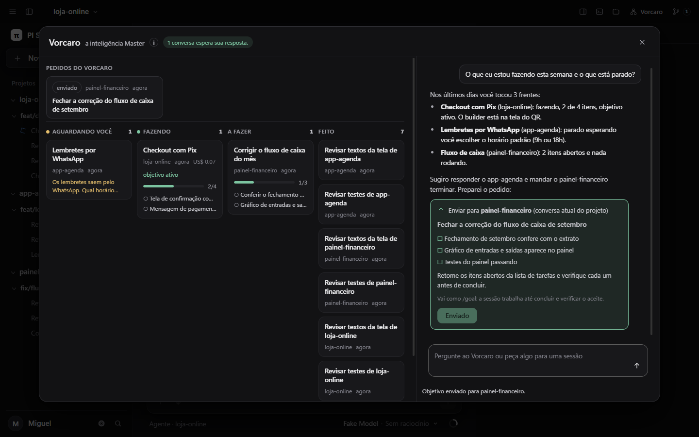
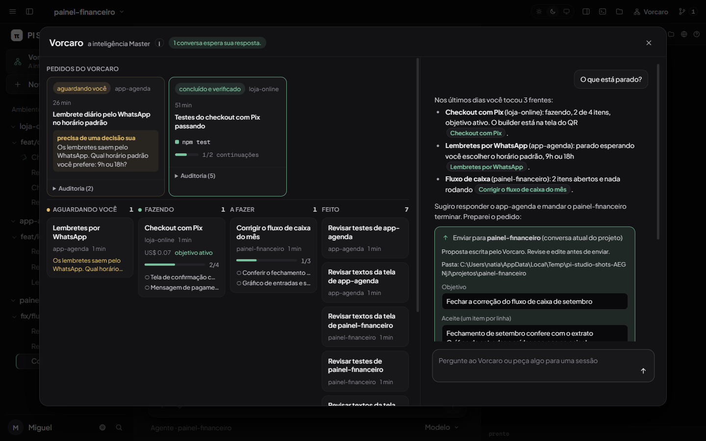

# Vorcaro, a inteligência Master

Pedido: uma central que conhece as sessões recentes, responde sobre tudo, monta quadro e checklist, sugere o que fazer e manda o pedido para a sessão escolhida, que trabalha até concluir. Entregue no patch `studio-patches/0003-vorcaro.patch`. Botão "Vorcaro" na barra superior ou `Alt+V`.

## Como funciona

1. **Memória: um resumo por sessão, não forks.** Para cada sessão principal de PI mexida nos últimos 7 dias, o Studio extrai do próprio log um resumo: título, projeto, pedido inicial, último pedido, última resposta, itens abertos da lista de tarefas, estado do `/goal`, custo e última atividade. Não chama modelo (sai de graça, sempre igual), só relê um arquivo quando ele muda, e grava tudo em `~/.pi/agent/pi-studio-data/vorcaro-digests.json`. Sessões de subagentes entram pela sessão mãe.
2. **Respostas: um PI somente leitura.** O Vorcaro é o mesmo motor da aba Dúvidas: um PI lateral com read, grep, find e ls, que não grava sessão nem aceita comandos com `/` ou de shell. Ele lê primeiro `vorcaro-sessoes.md` (os resumos em texto) e, quando precisa de detalhe, o log da sessão.
3. **Quadro.** As sessões ficam em quatro colunas: Aguardando você (a última resposta pergunta algo, o objetivo está bloqueado ou há um diálogo aberto no Studio), Fazendo (rodando agora, ou com objetivo ativo e atividade recente), A fazer (itens abertos e nada rodando) e Feito. Cada cartão mostra projeto, quando mexeu, custo, a pergunta pendente e o progresso dos itens com barra. Clicar abre a conversa. No topo aparecem avisos como "1 conversa espera sua resposta".
4. **Mandar fazer, com confirmação.** Quando você pede algo para uma sessão, o Vorcaro reescreve o pedido como objetivo, checklist de aceite e instruções, num cartão com o botão "Enviar para a sessão". Ele nunca envia sozinho. Ao clicar, o Studio reabre a conversa indicada (ou usa a conversa atual do projeto) e manda um único `/goal` com o checklist. O pi-goal mantém a sessão trabalhando até `goal_complete` ou `goal_blocked`, e a extensão autopilot retoma quando sobram itens na lista de tarefas. O Vorcaro não repete essa lógica.
5. **Acompanhar.** Cada pedido enviado aparece no topo do quadro com estado ao vivo, lido do resumo da sessão de destino: enviado, trabalhando, aguardando você, bloqueado, parou sem concluir, concluído e verificado. Desde a v1, "concluído e verificado" só aparece depois que o próprio Vorcaro rodou a verificação aprovada e ela passou (veja abaixo).

Segurança:
- Os logs trazem texto de terceiros (páginas e arquivos que os agentes leram). Por isso nenhum bloco de código dos logs chega ao Vorcaro: os resumos neutralizam cercas de código e a palavra do bloco de ação. O arquivo e o prompt dizem que resumos e logs são dados, nunca instrução, e que só se propõe envio quando a própria pessoa pede na conversa.
- Nada sai sem clique, e a proposta é tratada como texto do modelo: o cartão avisa "Proposta escrita pelo Vorcaro. Revise e edite antes de enviar.", mostra a pasta completa e a conversa indicada (que não podem ser editadas) e traz objetivo, aceite e instruções em campos editáveis. Vai no `/goal` exatamente o que ficou nos campos. O Vorcaro ainda pode ler logs crus para responder com detalhe; a proteção está em nada ser enviado sem essa revisão.
- O servidor só aceita um projeto que o Studio já conhece, uma worktree listada pelo Orca ou uma pasta dentro das raízes de projeto. Quando uma conversa é indicada, ele só envia se for exatamente ela que está aberta no PI do projeto (409 em qualquer outro caso). Se ela estiver rodando em outro lugar (terminal do Orca ou outro PI), o envio para e avisa.

## Feito nesta rodada e o que falta

Feito: camada de resumos persistida, perguntas e respostas sobre tudo, quadro com checklist e avisos, briefing com objetivo e aceite, envio por `/goal` após confirmação, reabertura da conversa escolhida e acompanhamento do estado de cada pedido.

Falta:
- Feito na v1 (abaixo): verificação própria e retomada com limite.
- Verificação de entrega que não é comando (abrir uma tela, conferir um texto): hoje o pedido para em "aguardando você" para a pessoa olhar.
- Resumo escrito por modelo (Luna) além do resumo extraído do log, e memória de longo prazo e camada de skills e ferramentas próprias (o desenho já reserva lugar: o resumo é um registro com campos, e o Vorcaro é um PI lateral cujas ferramentas e prompt mudam num só lugar).
- Escolher o modelo do Vorcaro (hoje usa o modelo padrão do PI).

## Vorcaro v1 (patch `0006-vorcaro-v1.patch`)

O que mudou, seguindo a "Proposta Vorcaro v1":

1. **Verificação própria antes de "feito".** A proposta ganhou o campo "Verificação do Vorcaro" (um comando por linha). Depois que a sessão diz que terminou (`goal_complete`, ou a rodada acaba sem itens abertos), o Studio roda esses comandos na pasta do projeto e só marca "concluído e verificado" se todos passarem. Aceita só executores de teste, lint e build (`npm test`, `node --test`, `pytest`, `cargo test` e parecidos), em palavras simples: nada de `;`, `&&`, `|`, aspas, variáveis ou `..`. Um comando fora disso é descartado no servidor. Sem comando aprovado, o pedido para em "aguardando você" para você conferir.
2. **No máximo duas continuações curtas, com orçamento.** Se a verificação falha (ou a sessão para sem concluir), o condutor manda uma continuação: o objetivo de novo como `/goal`, os comandos que falharam e o fim da saída deles. O texto vem só dos comandos que o Vorcaro rodou, nunca do que a sessão escreveu. Limites: 2 continuações, 2 min entre elas, nenhuma antes de a sessão reagir à anterior, 60 min e US$ 3 por pedido. Passou disso, para e pergunta "quer mais duas rodadas?".
3. **Sem duplicar o autopilot do NatiamG.** Enquanto o objetivo está ativo, ele é do pi-goal e do autopilot: o condutor não manda nada. Também não manda enquanto a sessão roda ou mostra um diálogo, e nunca responde um diálogo pelo usuário.
4. **Bloqueios tipados.** Cada pedido parado diz por quê: falta uma credencial, precisa de uma resposta sua, precisa de uma decisão sua, falta uma ferramenta ou acesso, erro passageiro, sem progresso, orçamento esgotado, a verificação falhou, a sessão foi encerrada. Credencial e ferramenta vão para "bloqueado"; pergunta e decisão para "aguardando você", com a pergunta no cartão.
5. **Respostas com fonte.** Cada sessão no resumo tem um `ref` curto e estável. O Vorcaro cita `[fonte: ref]` depois de cada fato e diz que não sabe quando o resumo não tem o fato. Na tela, a citação vira um botão com o título da sessão que abre a conversa.
6. **Auditoria.** Cada passo (enviado, verificação iniciada, resultado, continuação, parado, concluído) vai para `~/.pi/agent/pi-studio-data/vorcaro-auditoria.jsonl`, só acréscimo, e aparece no cartão em "Auditoria".
7. **Idle-reaper.** Um PI do Studio com pedido do Vorcaro em aberto, ou cuja última resposta pergunta algo ao usuário, não é encerrado por ociosidade (além das regras de antes: rodando, com diálogo, com janela aberta).

Onde mora: `lib-server/vorcaro-conductor.mjs` (decisão pura `nextStep`, comandos permitidos, execução, continuação, auditoria) e o passe `vorcaroConduct` no `server.mjs`, que roda a cada minuto junto com o idle-reaper e a cada leitura do quadro. Não chama modelo.

## Testes

`test/vorcaro-conductor.test.mjs` (v1): tipos de bloqueio, lista de comandos permitidos (e os recusados), verificação antes de "feito", nenhuma continuação com objetivo ativo ou sessão rodando, no máximo duas, espaçadas e só depois de a sessão reagir, orçamento, sessão encerrada, mensagem de continuação sem texto da sessão, execução com processo falso, auditoria, idle-reaper e citações com ref estável.

`test/vorcaro.test.mjs`: resumo de uma sessão real em formato de log (título, pedidos, itens, objetivo que é limpo depois de concluir, custo), sessões de subagente e arquivos quebrados fora, regras de coluna (inclusive "um log que parou no meio não é trabalho"), índice que reaproveita, persiste e respeita a janela de 7 dias, texto dos resumos sem travessão, quadro com avisos e o estado de cada pedido, validação das propostas, mensagem do `/goal`, cartões do navegador, e as rotas com o PI falso: quadro, sessão do Vorcaro somente leitura (recusa `/goal` e shell), envio com pasta inválida (400), fora das raízes (403) e válido (201, pedido registrado e visível no quadro). Suíte completa do Studio com os três patches: 673 aprovados, 0 falhas. Há também o teste de que um bloco de ação plantado num log não chega ao Vorcaro e o de que uma conversa indicada que não está aberta é recusada (409).
