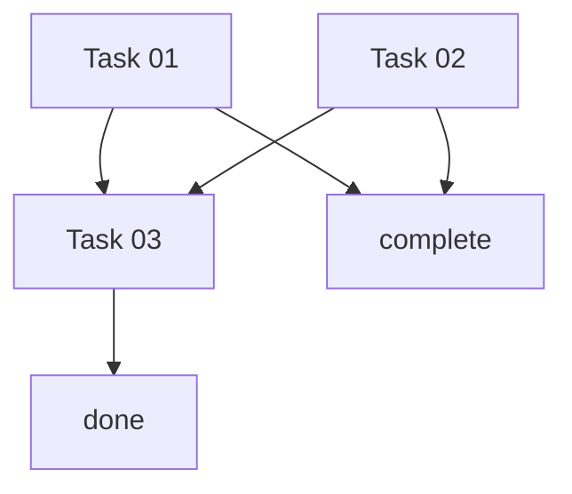

# Schedule: [Plan Title]

**Plan**: `.pi/plans/PLAN_FULL.md`
**Generated**: [ISO date]
**Updated**: [ISO date]
**Status**: planning | in_progress | complete | failed

---

## Task Table

| ID | Task File | Agent | Status | Dependencies | Parallel Group | Files Touched |
|----|-----------|-------|--------|--------------|----------------|---------------|
| 01 | TASKS/task_01_builder.md | builder | pending | none | group_1 | src/components/Component.tsx |
| 02 | TASKS/task_02_builder.md | builder | pending | none | group_1 | src/services/service.ts |
| 03 | TASKS/task_03_builder.md | builder | pending | 01, 02 | none | src/app/page.tsx |

**Status values**: 
- `pending` — Not started
- `in_progress` — Currently executing
- `complete` — Successfully finished
- `blocked` — Cannot proceed (missing prerequisites)
- `error` — Failed with errors
- `skipped` — Intentionally skipped

---

## Execution DAG

```text
group_1: [01, 02]  →  task 03  →  done
```

Or in mermaid syntax:


---

## Parallel Groups

### group_1
- **Tasks**: [01, 02]
- **Safety**: These tasks touch DISJOINT file sets.
- **Conflict detection**: Tasks 01 and 02 touch no common files.
- **Why parallel**: Independent components, no shared state

### group_N (template)
- **Tasks**: [NN, MM]
- **Safety**: These tasks touch DISJOINT file sets.
- **Conflict detection**: Verify no shared imports or dependencies

---

## Orchestrator Rules (READ-ONLY for builders)

1. **Parallel execution**: Only tasks within the same `Parallel Group` may run concurrently.
2. **Dependency enforcement**: A task may only start after ALL its `Dependencies` show `status: complete`.
3. **Status updates**: The orchestrator (parent agent) updates the `Status` column. Builders do NOT modify this file.
4. **Blocked handling**: If any task shows `status: blocked`, pause its parallel group. Do not start dependent tasks.
5. **Completion**: When all tasks show `status: complete`, the schedule is done.

---

## Execution Log

| Timestamp | Action | Task ID | Details |
|-----------|--------|---------|---------|
| [ISO] | planned | all | Plan ecosystem generated |
| [ISO] | started | 01 | Builder spawned |
| [ISO] | started | 02 | Builder spawned |
| [ISO] | complete | 01 | Handover received: COMPLETE |
| [ISO] | complete | 02 | Handover received: COMPLETE |
| [ISO] | started | 03 | Builder spawned |
| [ISO] | complete | 03 | Handover received: COMPLETE |
| [ISO] | complete | all | All tasks finished |

---

## Notes

[Any additional notes for the orchestrator]
